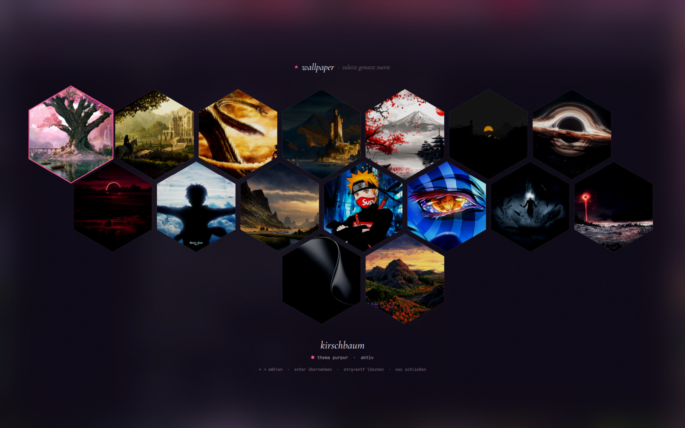
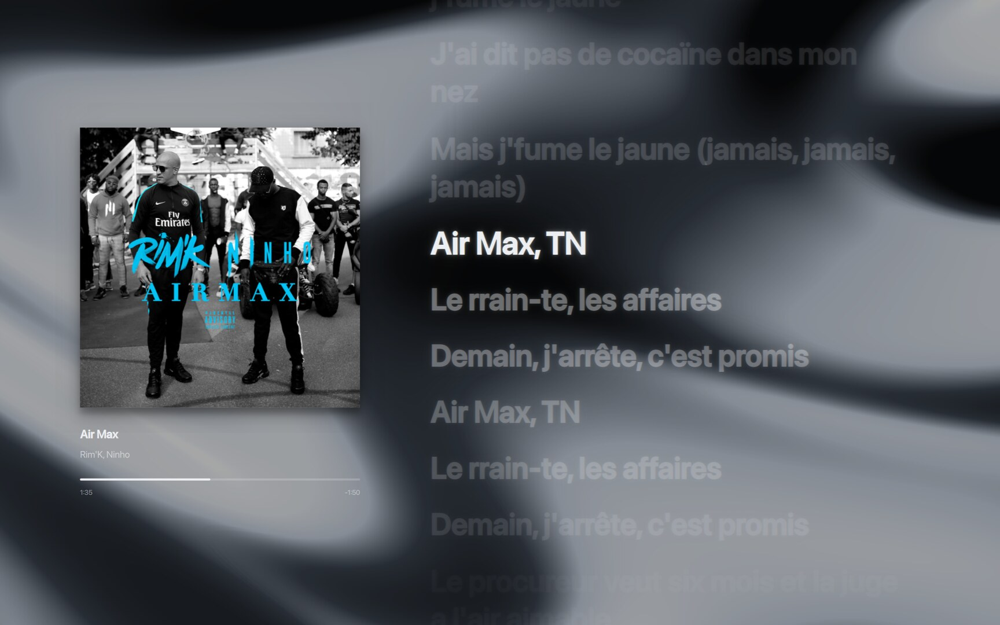
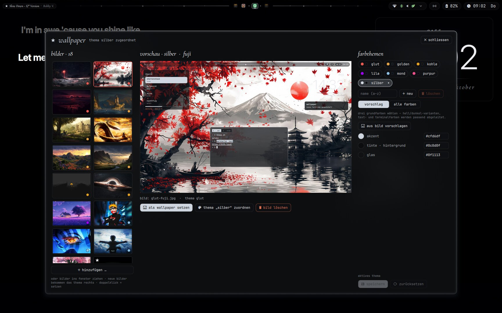

<div align="center">

# Fedora + Hyprland + Quickshell

**A personal Wayland desktop setup: glass look with blur, a custom bar and panels, and color themes that follow the wallpaper.**


</div>

---

## Look

<table>
  <tr>
    <td width="50%"><br><sub><b>Windows</b>: glass, blur, rounded corners, matching the color theme</sub></td>
    <td width="50%"><br><sub><b>Wallpaper gallery</b> (Super+W): the color theme changes with the picture</sub></td>
  </tr>
  <tr>
    <td colspan="2"><br><sub><b>Lyrics screen</b> (Super+Shift+M): cover on the left, big synced lyrics on the right, a moving blurred background made from the wallpaper and theme colors</sub></td>
  </tr>
  <tr>
    <td colspan="2"><br><sub><b>Wallpaper app</b>: add pictures, create and edit color themes with a live mini-desktop preview</sub></td>
  </tr>
</table>

> The interface labels are in German.

## What's inside

- **Hyprland with a Lua configuration** (`hypr/hyprland.lua`, not hyprlang): monitors, autostart, input, keybindings, window and layer rules.
- **Quickshell UI in QML** (`quickshell/`): top bar with taskbar, control center (Wi-Fi, Bluetooth, sound, night mode, rolling one-month calendar with your Google events), desktop clock, volume OSD.
- **Task view with live previews** (Super+Tab) and an Alt+Tab window switcher.
- **Music panel** like a small Spotify (Web API): playlists, search, controls, plus **synced lyrics** on the desktop.
- **Seven color themes** (`golden`, `glut`, `kohle`, `purpur`, `lila`, `mond`, `silber`) plus your own, made in the **Wallpaper app**: Hyprland, Quickshell, mako, rofi, kitty and hyprlock take their colors from the active theme.
- **AirDrop** panel (send files to iPhone/Mac) and **iPhone mirroring** (UxPlay).
- **Living wallpaper**: clouds drift, grass and trees move in the wind, water sparkles (GLSL shaders).
- **Window mode** tiled ↔ free (Super+O), drop-down terminal, hide windows instead of minimizing.
- **Plugins**: a custom wobbly-windows plugin in C++ (`hypr/plugins/wobbly`), plus [Phantomat](https://github.com/kaolti/phantomat) (infinite window canvas) and HyprWindowShade (window shaders).
- **Lock screen and idle** (hyprlock, hypridle), notifications (mako), launcher (rofi), terminal (kitty).
- **GRUB boot menu and Plymouth splash** for dual boot: generator scripts in `hypr/grub-ghost` (images not included).

## Key bindings

`Super` is the Windows key. The full list is shown by **Super+I**.

| Binding | Action |
|---|---|
| `Super+Enter` | Terminal |
| `Super+Space` | App launcher |
| `Super+Tab` / `Alt+Tab` | Task view / window switcher |
| `Super+W` | Wallpaper gallery |
| `Super+O` | Window mode tiled ↔ free |
| `Super+P` | Phantom: all windows on one infinite canvas |
| `Super+M` | Music panel |
| `Super+Shift+M` | Fullscreen lyrics view |
| `Super+Shift+V` | Clipboard history |
| `Super+1…0` | Switch workspace |
| `Print` | Screenshot (area) |

## Layout

```
hypr/          Hyprland config (Lua), hypridle, hyprlock, color themes, scripts, plugins, docs
quickshell/    bar, panels, task view, music, wallpaper shader (QML + GLSL)
rofi/ mako/ kitty/   program configs, colors from hypr/themen/<name>/
```

The detailed documentation is in [`hypr/AGENTS.md`](hypr/AGENTS.md) (overview, files, keybindings, pitfalls) and [`hypr/docs/`](hypr/docs) (one file per topic). **The docs are written in German.**

## Notes

This is **my personal setup**, not a ready-made installer. If you want to borrow from it:

- Only tested on **Fedora 43**; Hyprland packages from the COPR `sdegler/hyprland`, Quickshell from the COPR `errornointernet/quickshell`.
- `hypr/monitors.lua` is tailored to my displays and gets overwritten by *nwg-displays*.
- The **plugins must be rebuilt after every Hyprland update** (`hypr/plugins/wobbly/build.sh`, `hypr/scripts/phantomat.sh`).
- **Not included**: wallpapers (`hypr/wallpapers/<theme>-<name>.jpg`), built `*.so` files, Spotify/OpenAI credentials (they live locally under `~/.local/state`).
- Fonts: Cormorant Garamond, JetBrainsMono Nerd Font, Symbols Nerd Font; the clock and lyrics use SF Pro Display (not included).
- Icons and cursor: WhiteSur.

## Questions

Want to build something similar and need help? Open an [issue](https://github.com/eduart-maliqi/fedora-hyprland/issues), I'm happy to help.
