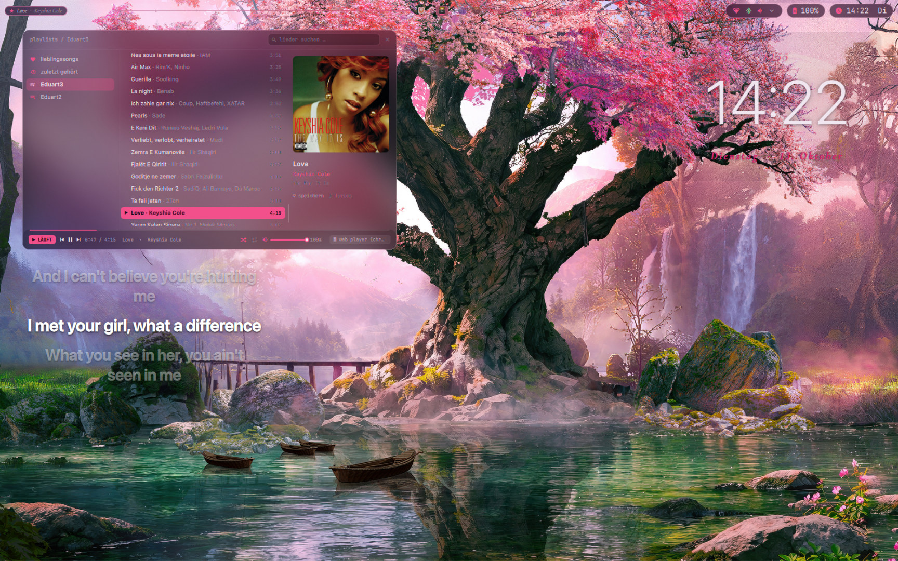
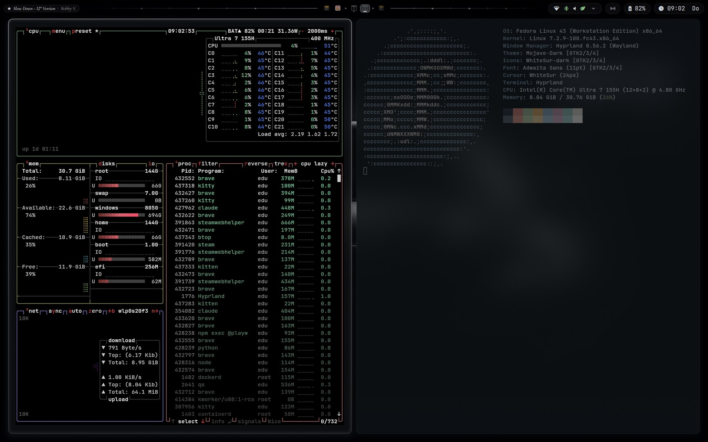
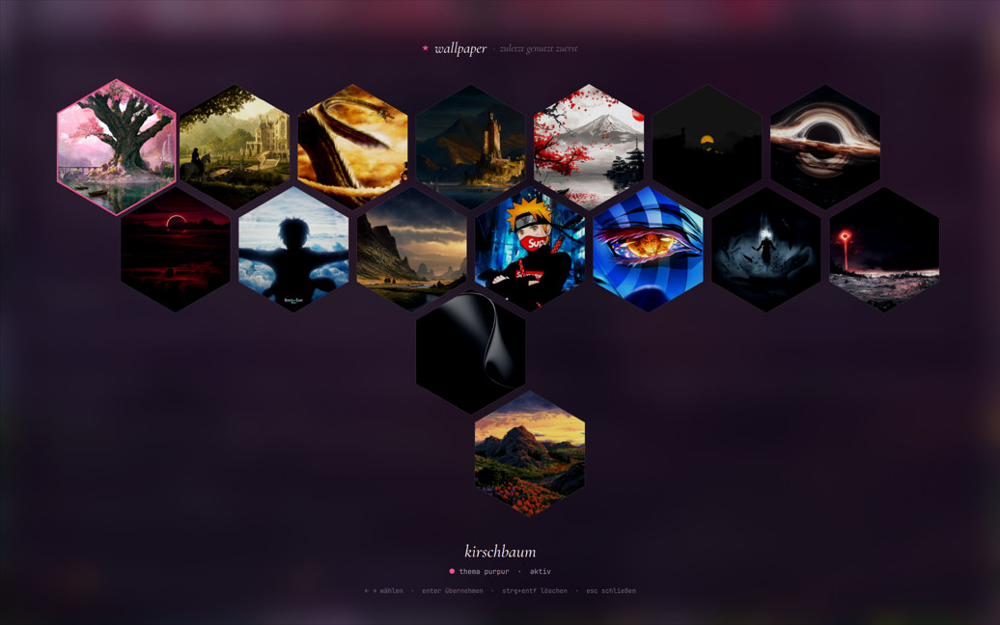
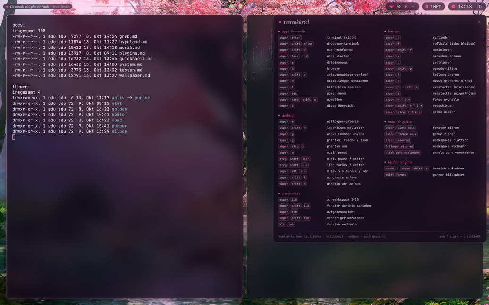

<div align="center">

# Fedora + Hyprland + Quickshell

**Ein persönliches Wayland-Desktop-Setup: Glas-Optik mit Blur, eigene Leiste und Panels, Farbthemen passend zum Wallpaper.**




</div>

---

## Aussehen

<table>
  <tr>
    <td width="50%"><br><sub><b>Fenster</b> – Glas, Blur, abgerundete Ecken, passend zum Farbthema</sub></td>
    <td width="50%"><br><sub><b>Wallpaper-Galerie</b> (Super+W) – das Farbthema wechselt mit dem Bild</sub></td>
  </tr>
  <tr>
    <td colspan="2"><br><sub><b>Super+I</b> zeigt alle Tastenkürzel als Spickzettel</sub></td>
  </tr>
</table>

## Was drin ist

- **Hyprland mit Lua-Konfiguration** (`hypr/hyprland.lua`, kein hyprlang): Monitore, Autostart, Eingabe, Tastenkürzel, Fenster- und Layer-Regeln.
- **Quickshell-Oberfläche in QML** (`quickshell/`): obere Leiste mit Taskleiste, Kontrollzentrum (WLAN, Bluetooth, Ton, Nachtmodus), Desktop-Uhr, Lautstärke-Anzeige.
- **Aufgabenansicht mit Live-Vorschau** (Super+Tab) und Alt+Tab-Fensterwechsler.
- **Musik-Panel** wie ein kleines Spotify (Web API): Playlists, Suche, Steuerung, dazu **synchronisierte Songtexte** auf dem Desktop.
- **Sechs Farbthemen** (`golden`, `glut`, `kohle`, `purpur`, `mond`, `silber`): Hyprland, Quickshell, mako, rofi, kitty und hyprlock ziehen die Farben aus dem aktiven Thema.
- **Lebendiges Wallpaper**: Wolken ziehen, Gras und Bäume im Wind, Wasser glitzert (GLSL-Shader).
- **Fenstermodus** geordnet ↔ frei (Super+O), Dropdown-Terminal, Fenster verstecken statt minimieren.
- **Plugins**: eigenes Wackelfenster-Plugin in C++ (`hypr/plugins/wobbly`), dazu [Phantomat](https://github.com/kaolti/phantomat) (unendliche Fensterfläche) und HyprWindowShade (Fenster-Shader).
- **Sperrbildschirm und Leerlauf** (hyprlock, hypridle), Benachrichtigungen (mako), App-Starter (rofi), Terminal (kitty).
- **GRUB-Bootmenü und Plymouth-Ladebildschirm** für Dualboot: Generator-Skripte in `hypr/grub-ghost` (die Bilder sind nicht enthalten).

## Wichtige Tastenkürzel

`Super` = Windows-Taste. Die vollständige Liste zeigt **Super+I**.

| Kürzel | Aktion |
|---|---|
| `Super+Enter` | Terminal |
| `Super+Leertaste` | App-Starter |
| `Super+Tab` / `Alt+Tab` | Aufgabenansicht / Fensterwechsler |
| `Super+W` | Wallpaper-Galerie |
| `Super+O` | Fenstermodus geordnet ↔ frei |
| `Super+P` | Phantom: alle Fenster auf einer unendlichen Fläche |
| `Super+M` | Musik-Panel |
| `Super+Shift+V` | Zwischenablage-Verlauf |
| `Super+1…0` | Workspace wechseln |
| `Druck` | Screenshot (Bereich) |

## Aufbau

```
hypr/          Hyprland-Config (Lua), hypridle, hyprlock, Farbthemen, Skripte, Plugins, Doku
quickshell/    Leiste, Panels, Aufgabenansicht, Musik, Wallpaper-Shader (QML + GLSL)
rofi/ mako/ kitty/   Konfiguration der Programme, Farben aus hypr/themen/<name>/
```

Die ausführliche Doku steht in [`hypr/AGENTS.md`](hypr/AGENTS.md) (Überblick, Dateien, Tastenkürzel, Fallstricke) und in [`hypr/docs/`](hypr/docs) (je Thema eine Datei).

## Hinweise

Das ist **mein persönliches Setup**, kein fertiger Installer. Zum Übernehmen gilt:

- Getestet nur mit **Fedora 43**; Hyprland-Pakete aus COPR `sdegler/hyprland`, Quickshell aus COPR `errornointernet/quickshell`.
- `hypr/monitors.lua` ist auf meine Bildschirme zugeschnitten und wird von *nwg-displays* überschrieben.
- Die **Plugins müssen nach jedem Hyprland-Update neu gebaut werden** (`hypr/plugins/wobbly/build.sh`, `hypr/scripts/phantomat.sh`).
- **Nicht enthalten**: Wallpapers (`hypr/wallpapers/<thema>-<name>.jpg`), gebaute `*.so`, Spotify-/OpenAI-Zugangsdaten (liegen lokal unter `~/.local/state`).
- Schriften: Cormorant Garamond, JetBrainsMono Nerd Font, Symbols Nerd Font; Uhr und Songtexte nutzen SF Pro Display (nicht enthalten).
- Symbole und Cursor: WhiteSur.
